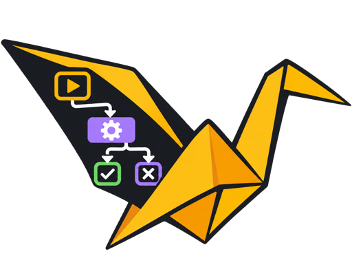
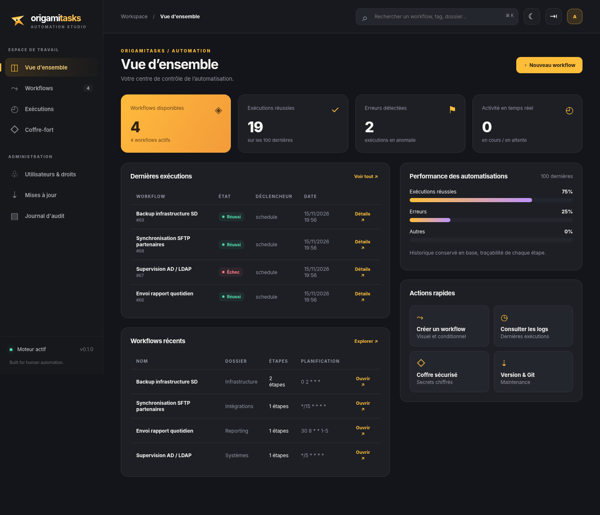
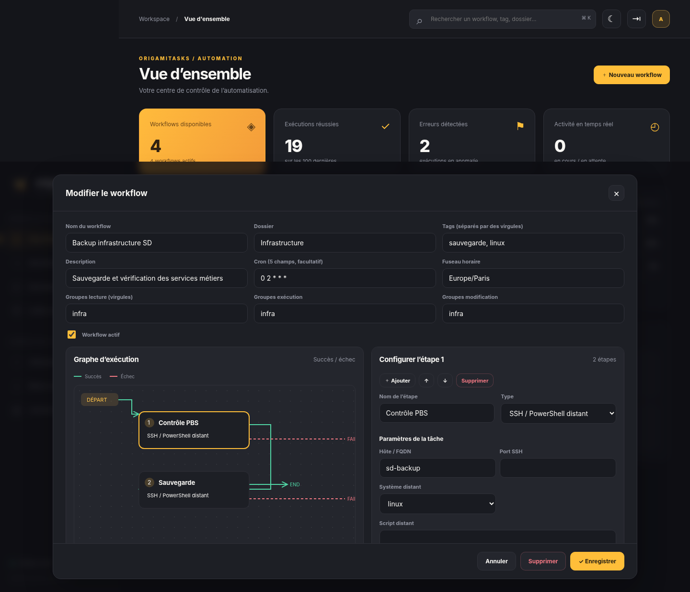
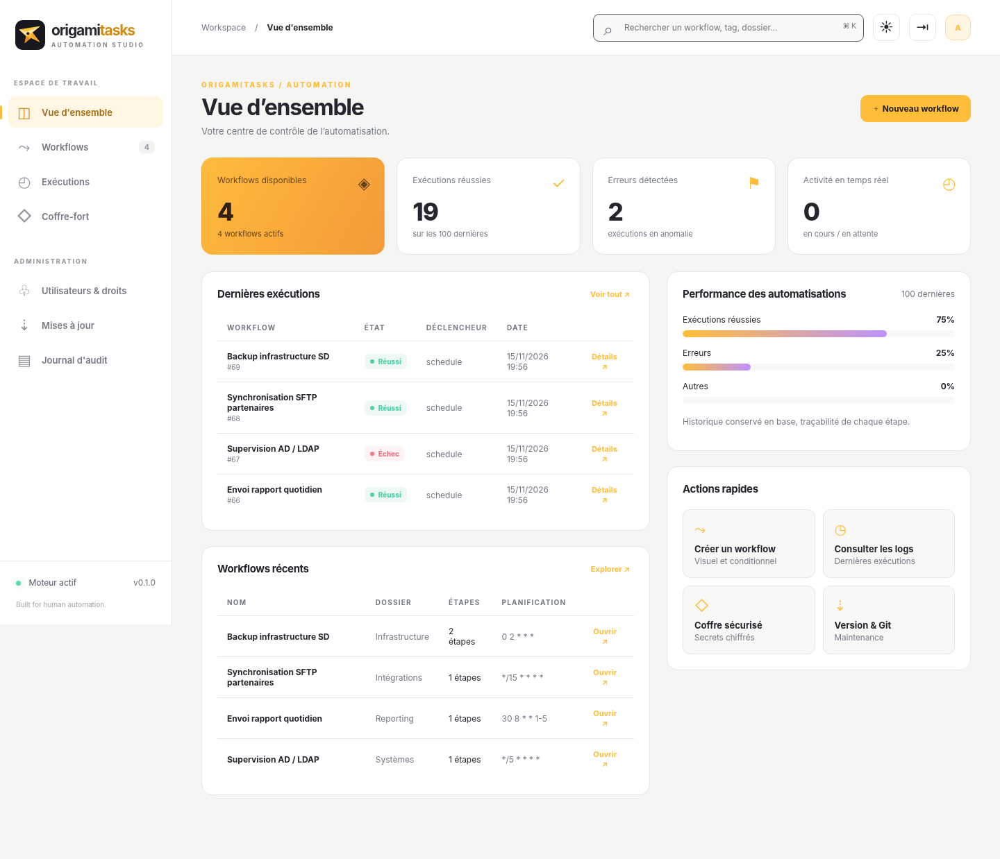
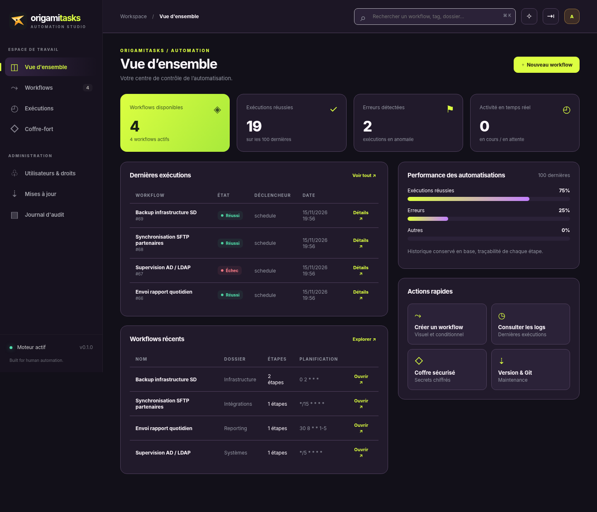

<div align="center">


# OrigamiTasks

**L'orchestrateur de tâches auto-hébergé pour Linux et Windows.**

*Organisez. Déclenchez. Décidez. Automatisez.*


</div>

---

## Aperçu de l’interface

*Captures réalisées avec l’interface réelle et des données de démonstration, et non des tâches réellement exécutées.*



<details><summary>Éditeur de workflows et thèmes alternatifs</summary>






</details>

## À propos

OrigamiTasks est un **premier produit fonctionnel / MVP auto-hébergé**, inspiré des concepts de VisualCron (déclencheur → conditions → tâches → flux). Il tourne sur un serveur Linux et exécute des étapes locales (option de confiance) ou distantes par SSH sur Linux **et** Windows équipé d'OpenSSH.

Il comprend une interface web responsive et un éditeur graphique de branches succès/échec, une base d'historique, un coffre de secrets chiffré, une authentification LDAP sécurisée, des ACL par groupes et des mises à jour depuis Git sous contrôle d'un worker hôte séparé.

> **Périmètre et sécurité :** c'est une base solide à développer et auditer, pas un clone intégral de VisualCron ni une plateforme pré-certifiée production. Les connexions LDAP/Windows/FTP/SFTP/SMTP nécessitent des tests dans votre infrastructure avant toute exploitation. L'exécution de scripts est **un privilège élevé**. Ne donnez pas la modification des scripts à des groupes non fiables. Consultez [SECURITY.md](docs/SECURITY.md).

## Aperçu fonctionnel

| Fonctionnalité | Implémentation v0.2 |
|---|---|
| Dashboard, recherche, filtres dossiers/tags | ✅ Interface SPA sans CDN |
| Thèmes anthracite/melon, clair, cyberpunk violet/néon | ✅ |
| Workflow multi-étapes, succès/échec, sauts, conditions | ✅ Jusqu'à 80 étapes et 200 transitions par exécution |
| Reprise automatique des étapes échouées | ✅ 0 à 5 reprises configurables |
| Horaires cron & fuseaux | ✅ cron à 5 champs, Europe/Paris par défaut |
| Webhooks / variables d’exécution | ✅ Jeton haché, JSON vers variables, étape Set variable |
| Shell Linux, PowerShell local | ⚠️ Disponible si activé et interpréteur présent |
| Shell Linux et PowerShell Windows distants | ✅ SSH + scripts PowerShell encodés, hôte approuvé |
| FTP / FTPS, SFTP | ✅ Upload/download dans `data/transfers` |
| SMTP, HTTP/REST, pause | ✅ TLS SMTP, HTTP Bearer token |
| Coffre de secrets | ✅ Fernet ; clé hors Git ; pas de lecture de secret par API |
| LDAP / AD, groupes et droits par workflow | ✅ LDAPS / STARTTLS ; groupes directs (nested AD en option) |
| Historique, sorties stdout/stderr, audits | ✅ SQLite |
| Mise à jour demandée depuis le web | ✅ Via worker indépendant *à installer sur l'hôte* |
| Matrix — publier un message dans une room | ✅ Bot token stocké dans le coffre, idempotence par run/étape ; room non E2EE |
| Ansible — lancer un playbook depuis le workflow | ✅ Runner SSH dédié, chemins restreints, `--check`, inventaire, limit et extra-vars |
| Proxmox — datacenters et inventaire | ✅ Enregistrement, nœuds, VM, LXC et stockages via API |
| Proxmox — actions contrôlées sur VM | ⚠️ Start / shutdown / reboot, option globalement désactivée par défaut |
| Catalogue de tâches web et roadmap | ✅ Disponible dans le menu « Catalogue des tâches » |
| Branches parallèles, agents natifs Windows, HA, réplication VM inter-DC | ⏳ Non inclus dans cette version |

## Nouveautés v0.2 — Matrix, Ansible, Proxmox

Le [catalogue complet des fonctionnalités](docs/FEATURE-CATALOG.md) distingue les tâches disponibles aujourd'hui des fonctionnalités planifiées, inspirées des familles VisualCron.

### Matrix — message de room

1. Dans **Coffre-fort**, créer un secret contenant `token` (token d’un bot Matrix déjà membre d’une room non chiffrée).
2. Configurer `MATRIX_ALLOWED_HOSTS=matrix.exemple.fr` dans `.env` et relancer le conteneur.
3. Dans **Workflows**, ajouter une étape **Message Matrix** : URL HTTPS racine du homeserver, identifiant de la room (`!roomid:exemple.fr`), message et credential.

L'envoi utilise l'API Matrix v3 avec un ID de transaction déterministe par exécution/étape. **L'envoi n'impose pas une popup** : l'affichage de la notification dépend des préférences et permissions du client Element. Les rooms E2EE nécessiteront une intégration Matrix gérant les clés ; non implémenté ici.

### Ansible — playbook via serveur runner

1. Installer Ansible sur une VM/runner **séparé** ; ouvrir SSH et enregistrer la clé hôte dans `data/known_hosts`.
2. Déployer les playbooks et inventaires (maintenus hors du conteneur OrigamiTasks) sous `/opt/origamitasks/ansible/playbooks/` et `/opt/origamitasks/ansible/inventories/`.
3. Ajouter une étape **Ansible Playbook** : hôte runner, playbook relatif, inventaire relatif, `limit`, variables JSON et mode `--check`.
4. Sélectionner dans le coffre l'identité SSH du compte de service d'exécution.

Le backend lance une commande `ansible-playbook` strictement construite (pas de fragment shell arbitraire), **sur le runner distant**. Les artefacts et les permissions restent à configurer sur ce runner. L'intégration avancée Ansible Runner isolé reste prévue pour une version ultérieure.

### Proxmox — découverte des datacenters

1. Créer un token API Proxmox dédié à la lecture, puis un secret OrigamiTasks : `username=user@pve!tokenid`, `token=SECRET`.
2. Déclarer dans `.env` les endpoints autorisés, par exemple `PROXMOX_ALLOWED_HOSTS=pve-au.example.fr:8006,pve-sd.example.fr:8006`.
3. Le conteneur vérifie le certificat TLS Proxmox ; en cas de CA interne, monter un fichier PEM sous `/app/data` et définir `PROXMOX_CA_CERT=/app/data/ca-proxmox.pem` (pas de désactivation TLS).
4. Dans **Datacenters**, déclarer un nom, une URL HTTPS `https://pve-au.example.fr:8006` et le credential, puis cliquer **Découvrir**.
5. Dans un workflow, ajouter l'étape **Proxmox VE** et sélectionner `inventory` (lecture seule) ou une opération VM encadrée.

Par défaut, `ALLOW_PROXMOX_ACTIONS=false` bloque les actions `start`, `shutdown`, `reboot`. Un administrateur doit activer explicitement ce verrou serveur et l'option de l'étape avant toute utilisation. Cette première version **ne migre ni ne réplique les VM entre clusters**. Pour l’architecture et les risques PRA : [design Proxmox DR](docs/PROXMOX-DR-DESIGN.md).

**Exemple importable via l'API** : [Ansible + Matrix](examples/ansible-matrix-maintenance.json). Ne pas saisir de secrets dans les variables JSON.

## Déploiement sur Debian 12/13 ou Ubuntu

### 1. Préparer le serveur

Prérequis : serveur Linux, Docker Engine + plugin Docker Compose, Python 3 pour le bootstrap, Git et un reverse proxy HTTPS (Nginx, Traefik ou Caddy). La machine doit pouvoir résoudre les cibles LDAP/SSH/SMTP. La machine web ne doit pas être exposée directement à Internet en HTTP.

```bash
sudo mkdir -p /opt
cd /opt
sudo git clone https://github.com/Maxime3d77/OrigamiTasks.git origamitasks
cd /opt/origamitasks
sudo bash ops/bootstrap.sh
```

**Attention :** le dépôt GitHub source est actuellement public. Ne jamais y placer de secrets, de données utilisateur ou des scripts internes confidentiels.

Le bootstrap affiche **une seule fois** le mot de passe de `admin`, crée une clé Fernet et écrit `.env` en mode 0600. Sauvegarder ce mot de passe et cette clé hors du serveur. Ne jamais committer `.env`.

### 2. Configurer le serveur

Éditer `.env` :

```dotenv
COOKIE_SECURE=true
ORIGAMI_PORT=8080
ALLOW_LOCAL_EXECUTION=false
```

Configurez votre reverse proxy HTTPS pour `http://127.0.0.1:8080`. Le conteneur n'est lié qu'à l'adresse locale de l'hôte. Pour un test sur localhost **uniquement**, `COOKIE_SECURE=false` permet de se connecter en HTTP, mais doit redevenir `true` pour l'exploitation.

```bash
sudo docker compose up -d --build
sudo docker compose ps
curl -f http://127.0.0.1:8080/api/health
```

**Connexion :** utilisateur `admin`, mot de passe initial généré par `ops/bootstrap.sh`. Le premier workflow peut être testé sans privilèges de script avec une étape **Pause** (1 seconde).

> Important : le volume `data` doit être inscriptible par UID 10001. Si le bootstrap n'a pas été lancé en root, effectuer `sudo chown -R 10001:10001 data`.

### 3. Définir des workflows

Dans **Workflows → Créer**, renseigner le nom, le dossier, les tags, l'ACL (groupes lecture / exécution / modification), une éventuelle expression cron puis ajouter des étapes.

Pour chaque étape : type, configuration, nombre de reprises, délai, destination si réussite ou si échec, condition préalable. Le graphe est interactif. `END` termine le workflow avec succès, `FAIL` avec échec. Un champ de branche vide suit automatiquement l'étape suivante en cas de succès et arrête en échec en cas d'erreur.

Quelques expressions cron :

```text
0 8 * * 1-5   # 08 h du lundi au vendredi
*/15 * * * *  # toutes les 15 minutes
30 2 * * 0    # dimanche à 02:30 (heure du fuseau choisi)
```

**Interpolation (dans les scripts, URLs et champs textuels)** : `{{ run.id }}`, `{{ steps.etape_1.output }}`, `{{ steps.etape_1.status }}`, `{{ steps.etape_1.exit_code }}`, `{{ var.nom }}`. Dans cette v0.2, aucune interface n'écrit de variables de workflow ; les valeurs `var.*` non définies se résolvent en chaîne vide. Les secrets ne sont pas disponibles par interpolation directe.

### 4. Exécuter à distance (Linux et Windows)

OrigamiTasks utilise **SSH** pour les scripts distants, afin que le serveur d'ordonnancement reste sous Linux. Pour Windows : installer et démarrer **OpenSSH Server**, autoriser le port SSH dans le pare-feu, prévoir un compte de service et les droits Windows appropriés. Type d'étape `SSH / PowerShell distant`, plateforme `windows` ; le script est exécuté par `powershell.exe -EncodedCommand`.

Sur Linux : type `SSH / PowerShell distant` avec plateforme `linux`, exécuté par `bash -lc`.

**Vérification obligatoire de l'empreinte hôte** : toutes les connexions Paramiko refusent les hôtes inconnus. Enregistrer chaque empreinte **après vérification hors bande**, dans `data/known_hosts`, par exemple en vérifiant `ssh-keyscan -H serveur.example` avec les empreintes fournies par l'équipe infra. Le seul scan non vérifié n'est pas une preuve de confiance.

Le coffre de secrets accepte nom d'utilisateur, mot de passe, clé privée SSH et passphrase. Aucun mot de passe n'est renvoyé à l'interface après enregistrement.

Un administrateur peut aussi ouvrir le menu **Webhook** d’un workflow pour générer un secret affiché une seule fois (réutilisable ensuite jusqu’à sa révocation) et une URL POST `/api/hooks/{id}`. Ajouter l’en-tête `X-Origami-Webhook-Token`. Un corps JSON comme `{"ticket_id":"123"}` rend `{{ var.ticket_id }}` disponible dans les étapes.

Les tâches de transfert ne voient que `data/transfers`. Une tâche SFTP ou FTPS `put` envoie un fichier de cette zone ; `get` l'y télécharge. Le FTP non chiffré requiert l'option explicite `allow_plaintext`.

### 5. Authentification LDAP / Active Directory

Configurer `.env` en privilégiant LDAPS et une **CA de confiance** :

```dotenv
LDAP_URI=ldaps://dc01.exemple.local:636
LDAP_BASE_DN=DC=exemple,DC=local
LDAP_BIND_DN=CN=svc-origami,OU=ComptesTechniques,DC=exemple,DC=local
LDAP_BIND_PASSWORD=SECRET_A_CONSERVER_HORS_GIT
LDAP_USER_ATTRIBUTE=sAMAccountName
LDAP_ADMIN_GROUP=origamitasks-admins
LDAP_OPERATOR_GROUP=origamitasks-operators
LDAP_VIEWER_GROUP=origamitasks-viewers
LDAP_GROUP_BASE_DN=DC=exemple,DC=local
LDAP_NESTED_GROUPS=true
# LDAP_CA_CERT=/app/data/ldap-ca.pem
```

Alternative `ldap://...:389` **uniquement** avec `LDAP_STARTTLS=true`. Les connexions LDAP en clair sont refusées. **Le bind applicatif exige un groupe de rôle** ; sans groupe autorisé, l'accès est refusé. Les noms CN sont normalisés en minuscules pour l'ACL des jobs. Les groupes imbriqués nécessitent AD et `LDAP_NESTED_GROUPS=true`. Si l'utilisateur appartient aux trois groupes, `admin` prime, puis `operator`, puis `viewer`.

Les ACL s'appliquent par groupe (une appartenance `edit` comprend lecture et exécution ; `run` comprend lecture). Les administrateurs peuvent tout gérer ; seules les personnes ayant le droit de modification du workflow peuvent éditer ses étapes ; les opérateurs ne peuvent pas changer les ACL.

**Limitation actuelle :** le compte `admin` est créé localement au premier démarrage et doit rester un accès de secours, avec mot de passe fort. L'interface ne gère pas encore les comptes locaux autres que cet administrateur ni la rotation de son mot de passe ; utiliser l'outil `ops/change-admin-password.py` ci-dessous.

### 6. Installer le service de mises à jour Git

La mise à jour via le web est séparée du conteneur pour **éviter le montage du socket Docker dans l'application**. Le dépôt Git sur l'hôte doit posséder un `origin` GitHub/GitLab **de confiance**, une branche `main` (configurable dans `.env`) et un arbre de travail propre. **Configurer impérativement `GIT_ALLOWED_ORIGIN` dans `.env` avec l’URL exacte retournée par `git remote get-url origin`** (GitHub ou GitLab privé approuvé).

```bash
sudo cp ops/origamitasks-updater.service /etc/systemd/system/
sudo systemctl daemon-reload
sudo systemctl enable --now origamitasks-updater
sudo systemctl status origamitasks-updater
```

Un clic **Mises à jour → Rechercher** demande au worker de faire `git fetch` et de comparer `HEAD`. Un clic **Installer** est confirmé par l'admin, enregistre une demande en SQLite, puis le worker : vérifie l'origine, refuse les branches non fast-forward, sauvegarde SQLite, redéploie avec `docker compose up -d --build`, attend le healthcheck et essaie un rollback applicatif en cas d'échec.

**Attention :** le worker hôte a le pouvoir de lancer Docker et doit être réservé à un serveur bien administré. L'origine Git constitue une *source de code exécutable de confiance* ; sécurisez les accès en écriture, protégez la branche principale, auditez la CI et conservez des sauvegardes **hors hôte**. Les migrations de schéma futures devront disposer de migrations réversibles.

### 7. Publier sur Git

```bash
# depuis le dossier OrigamiTasks, après création du dépôt distant privé
cd /opt/origamitasks
git init
git branch -M main
git add .
git commit -m "feat: initial OrigamiTasks automation studio"
git remote add origin git@github.com:VOTRE_COMPTE/OrigamiTasks.git
git push -u origin main
```

Aucun secret n'est dans les fichiers versionnés. **Ne pas ajouter `data/` ou `.env`.** Le worker de mise à jour requiert que la branche distante existe et que la source soit un dépôt Git local propre.

## Architecture

```text
Navigateur ── HTTPS reverse proxy ── FastAPI / API session+CSRF ─── SQLite WAL
                                          │                        │
                               Éditeur & ACL LDAP             Coffre Fernet
                                          │                        │
                              Scheduler cron  ───────► Run queue / moteur
                                                                  │
                                                   shell / pwsh (option)
                                                   SSH Linux / Windows
                                                   SFTP / FTPS / SMTP / HTTP

Admin web ──► table updates ──► worker systemd HÔTE ──► Git trusted fast-forward
                                               └──► backup SQLite + docker compose
```

Un seul processus Uvicorn (`--workers 1`) est requis : le scheduler et le moteur sont intégrés au service. Pour passer à une architecture multinœuds/HA, il faudra découpler le scheduler et les workers vers un broker ou une file distribuée et une base PostgreSQL.

## Tests

```bash
python3 -m venv .venv
source .venv/bin/activate
pip install -r requirements.txt pytest
pytest -q
node --check static/app.js
```

La CI GitHub exécute les tests backend. Les tests internes couvrent sessions + CSRF, création / exécution d'une tâche bash, historique, coffre, branches et groupes. La connectivité LDAP, Windows OpenSSH et les protocoles externes ne sont **pas** testés automatiquement ; voir [le plan de validation](docs/DEPLOYMENT-CHECKLIST.md).

## Identité visuelle

**OrigamiTasks** : une grue origami représente les flux qui se plient, se réorganisent et prennent une direction. Palette : melon `#FFBE39`, anthracite `#14151A`, blanc `#F7F6F3`. Thème alternatif cyberpunk violet `#C37FFF` / jaune néon `#DCFF41`. Favicon SVG et logo PNG inclus dans `static/`.

## Structure du dépôt

```text
app/                    API FastAPI, auth, coffre, moteur, adapters, scheduler
static/                 Interface web, styles, thèmes et identité de marque
ops/bootstrap.sh        Création des credentials bootstrap
ops/update-worker.py    Service hôte Git / Docker / rollback (opt-in)
ops/change-admin-password.py  Rotation du compte de secours
ops/*.service           systemd
.github/workflows/ci.yml  Tests automatisés
Dockerfile              Image non-root
docker-compose.yml      Web lié à 127.0.0.1
docs/                   Sécurité, architecture et checklist
```

## Licence

Voir [LICENSE](LICENSE) (MIT). « OrigamiTasks » n'est pas affilié à VisualCron ; l'architecture générale s'inspire de concepts usuels d'ordonnancement et n'incorpore pas leur code ni leur identité graphique.
