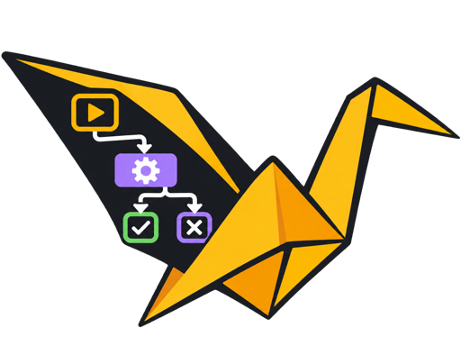

# Documentation OrigamiTasks



**OrigamiTasks** est un ordonnanceur de workflows auto-hébergé sous Linux, avec interface web, intégrations et exécutions distantes encadrées. Le produit est **en préproduction (v0.3.0-rc1)** : il ne possède pas encore toutes les fonctions de VisualCron.

## Accès rapide

- [Installation](installation.md) du service.
- [Configuration](configuration.md) TLS, secrets, LDAP et hôtes autorisés.
- [Workflows](workflows.md) avec branches de réussite et d'échec.
- [Catalogue des tâches](tasks.md) et [intégrations](integrations.md).
- [Proxmox et PRA](proxmox.md), scénarios compatibles et limites techniques.
- [Déploiement des agents](agents.md) Windows/Linux et sécurité.
- [Exploitation et mises à jour](operations.md), sauvegarde et rollback.
- [Matrice des fonctionnalités](roadmap.md) : disponible ou en projet.

## Architecture

```text
Navigateur --HTTPS--> Reverse proxy --> API / ordonnanceur OrigamiTasks
                                         | SQLite et coffre chiffré
                                         | moteur de workflows
                                         +--> SSH / OpenSSH Windows / runner Ansible
                                         +--> Matrix, SMTP, SFTP, HTTP
                                         +--> API REST Proxmox (lecture seule par défaut)
Mise à jour Git côté hôte <--- demande approuvée en base
```

**Sécurité :** l'exécution shell locale est désactivée par défaut. Un opérateur capable d'éditer un workflow exécutant du code privilégié est de fait privilégié sur la cible. Utiliser des runners isolés, comptes de service et droits minimaux.

## Politique de livraison

Toute modification de fonctionnalité, API, configuration, sécurité ou interface doit inclure une mise à jour des pages anglaises et françaises. La CI contrôle la présence des traductions et l'exactitude des types de tâches annoncés ; une relecture humaine reste indispensable.

Code et tickets : [GitHub](https://github.com/Maxime3d77/OrigamiTasks).

## Éléments ajoutés en v0.3

Les agents Linux/Windows et les blocs LDAP/AD sont maintenant disponibles en préversion. Le déploiement depuis l'administration nécessite une liste d'hôtes SSH autorisés et le HTTPS. Voir [Agents](agents.md) et [Tâches](tasks.md).
