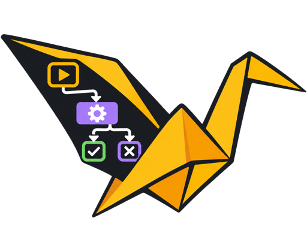

# OrigamiTasks Documentation



**OrigamiTasks** is a self-hosted workflow scheduler for Linux with a web control plane, managed integrations and controlled remote execution. The product is **pre-production (v0.3.0-rc1)**: do not assume VisualCron feature parity.

## Quick navigation

- [Install](installation.md) the single-node service.
- [Configure](configuration.md) TLS, secrets, LDAP and network allow-lists.
- [Build workflows](workflows.md) with success and failure branches.
- [Browse task reference](tasks.md) and [integrations](integrations.md).
- [Connect Proxmox](proxmox.md), review safe disaster-recovery options.
- [Deploy Linux and Windows agents](agents.md) for Windows/Linux and their trust model.
- [Operate and upgrade](operations.md) with backups and rollback.
- [Review the feature matrix](roadmap.md) for implemented versus planned features.

## Architecture

```text
Browser --HTTPS--> Reverse proxy --> OrigamiTasks API / scheduler
                                          | SQLite + encrypted vault
                                          | workflow executor
                                          +--> SSH / Windows OpenSSH / Ansible runner
                                          +--> Matrix, SMTP, SFTP, HTTP
                                          +--> Proxmox REST API (read-only by default)
Host-only Git updater <---- approval request in database
```

**Security boundaries:** local shell execution is disabled by default. Operators who can edit a workflow executing privileged code must be considered trusted on its execution target. Prefer isolated runners with dedicated service credentials and minimum privileges.

## Release policy

Documentation updates are required whenever a feature, API, configuration variable, security property or user workflow changes. A CI guard checks bilingual page parity and presence of all documented task adapters; technical verification and human translation review remain required.

For source code and issue reporting see [GitHub](https://github.com/Maxime3d77/OrigamiTasks).

## What's new in v0.3

Portable Linux/Windows agents and LDAP/AD task blocks are available as a preview. UI provisioning requires an explicit SSH host allow-list and HTTPS. See [Agents](agents.md) and [Tasks](tasks.md).
